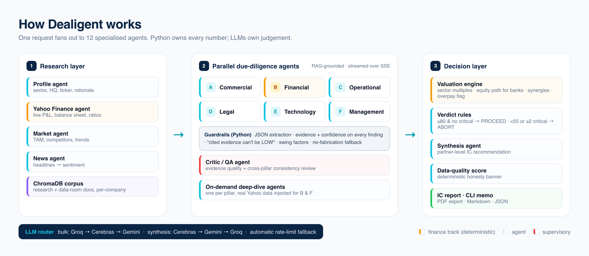

# Dealigent architecture

This document explains how a deal moves through Dealigent, which parts are deterministic Python and
which are LLM judgement, and why the system is shaped the way it is.



## 1. System overview

```mermaid
flowchart LR
    subgraph Client
        UI[React 19 SPA<br/>Zustand store · Recharts]
        CLI[Python CLI<br/>cli.py]
    end

    subgraph API[FastAPI · async]
        RS[/research/stream/]
        EX[/execute/&#123;id&#125;/stream/]
        DD[/deepdive/&#123;id&#125;/&#123;pillar&#125;/stream/]
        FI[/financials/&#123;id&#125;/]
        SY[/synthesis/&#123;id&#125;/]
        DO[/documents/&#123;id&#125;/upload/]
    end

    subgraph Agents
        RA[Research agents<br/>profile · yfinance · market · news]
        PA[6 pillar agents]
        CR[Critic / QA]
        DA[Deep-dive agents]
        SA[Synthesis agent]
    end

    subgraph Deterministic[Deterministic Python]
        VE[Valuation engine<br/>financials.py]
        GR[Guardrails + verdict<br/>runner.py]
        DQ[Data-quality score<br/>synthesis.py]
    end

    subgraph Data
        YF[(Yahoo Finance)]
        CH[(ChromaDB<br/>per-company corpus)]
        DB[(SQLite<br/>deals · pillar results)]
    end

    LLM{{LLM router<br/>Groq · Cerebras · Gemini}}

    UI --> RS & EX & DD & FI & SY & DO
    CLI --> RA & PA
    RS --> RA --> YF
    RA --> CH
    DO --> CH
    EX --> PA --> GR --> CR
    PA -. retrieve .-> CH
    FI --> VE --> YF
    SY --> DQ --> SA
    DD --> DA
    RA & PA & CR & DA & SA --> LLM
    EX --> DB
```



## 2. The agents

| Layer | Agent | Module | Model route | Output |
|---|---|---|---|---|
| Research | Profile | `agents/research/profile_agent.py` | Groq | sector, HQ, ticker hint, deal rationale |
| Research | Yahoo Finance | `agents/research/yfinance_agent.py` | none (pure Python) | multi-year P&L, ratios, officers, confidence + provenance |
| Research | Market | `agents/research/market_agent.py` | Apify → Groq fallback | market size, competitors, trends |
| Research | News | `agents/research/news_agent.py` | Groq | headlines → sentiment |
| Research | Seeder | `agents/research/runner.py` | none | research written into the company's ChromaDB slice |
| DD | Commercial … Management (×6) | `agents/runner.py` + `agents/prompts.py` | bulk route | score, summary, findings, red flags, key metrics, swing factors |
| Supervisory | Critic / QA | `agents/critic.py` | synthesis route | per-pillar quality, cross-pillar flags, reviewer verdict |
| On demand | Deep dive (×6) | `api/deepdive.py` + `agents/deepdive/prompts.py` | bulk route | rich pillar intelligence; real Yahoo data injected for Financial and Management |
| Decision | Synthesis | `api/synthesis.py` | synthesis route | IC recommendation, conditions precedent, value levers |

## 3. Execution model

`run_dd_graph` (in `agents/runner.py`) fans the enabled pillars out as asyncio tasks behind a
`Semaphore(2)`. The cap respects free-tier provider rate limits while still overlapping work. Each
agent streams tokens into an `asyncio.Queue`, and the SSE endpoint drains that queue to the browser.
The CLI drains the same queue to the terminal, so both front ends share one code path.

After every pillar finishes:

1. **JSON extraction** strips markdown fences and prose (`_extract_json`).
2. **Grounding**: every finding and red flag is forced to carry `evidence` and a normalised
   `confidence`. Findings that cite real evidence are never allowed to be LOW, and findings without
   evidence are labelled "Sector knowledge".
3. **Swing factors** are coerced into `{question, direction, impact}` and capped at 3.
4. The pillar records whether it was grounded in a **proprietary corpus** or **model knowledge only**.

Then the critic reviews all pillars, and finally the verdict is computed deterministically:

```python
if score >= 80 and critical_flags == 0:   PROCEED
elif score < 55 or critical_flags >= 2:   ABORT
else:                                     CONDITIONAL
```

If every provider fails, `_fallback_result` returns a neutral, clearly labelled placeholder. It never
fabricates company-specific numbers, and a test enforces that.

### SSE event schema

| Stream | Event `type` | Payload |
|---|---|---|
| research | `stage_start` / `stage_complete` | `stage`, `label`, `data` |
| research | `research_complete` | consolidated profile + financial summary |
| execute | `agent_start` | `pillar` |
| execute | `agent_chunk` | `pillar`, `chunk` (token text) |
| execute | `agent_complete` | `pillar`, `score`, `summary`, `findings`, `red_flags`, `key_metrics`, `swing_factors`, `grounding` |
| execute | `critic_start` / `critic_complete` | `review` |
| execute | `synthesis_complete` | `overall_score`, `verdict`, `pillar_scores`, `red_flags_all` |
| both | `done` | none |

Completed pillar results are persisted to SQLite, so replaying a finished deal costs no LLM calls.

## 4. The finance engine (deterministic)

`agents/financials.py` is the single source of truth for numbers.

- **Data:** `yfinance` income statement, balance sheet and `.info`. INR figures are reported in crore
  and everything else in millions; GBp quotes are normalised to GBP.
- **Ticker resolution:** an explicit ticker, then `yf.Search`, then Indian `.NS` / `.BO` patterns.
- **Sector multiples:** 15 sector profiles, each with low / mid / high EV/EBITDA and EV/Revenue.
- **Enterprise path** (industrials, tech, consumer…): standalone EV, then +25% control premium,
  +6% revenue synergies and +5% cost synergies, giving the fair offer.
- **Equity path** (banks, insurers, asset managers, or any negative EV): market cap with a
  −15% / +25% range, and fair offer = equity value +25% control premium. Synergies are not modelled.
- **Sanity check:** a deal value above 1.5× the fair offer is a HIGH overpay flag; below 0.6× is a
  MEDIUM "value opportunity or distress" flag.
- **Peers:** up to 3 live public comparables per sector. The target is excluded before the cap is applied.

All of this is covered by `tests/test_valuation.py`.

## 5. Retrieval (RAG)

ChromaDB holds one collection, and every chunk is tagged with its `company`. `query_context` only
ever retrieves the **current target's** chunks, so one deal's data never leaks into another deal.
Chunks come from three places: the research seeder, uploaded data-room documents (PDF/TXT/MD,
~1,000 characters with 150 characters of overlap, split on sentence boundaries), and the illustrative
Personio demo corpus.

## 6. LLM routing

`agents/llm.py` puts one interface over three providers. Whichever providers have keys take part,
and a rate-limit error (429 / quota / `RESOURCE_EXHAUSTED`) falls through to the next one,
honouring the `retryDelay` hints.

| Route | Order | Used by |
|---|---|---|
| `bulk` | Groq → Cerebras → Gemini | research, 6 DD agents, deep dives |
| `synthesis` | Cerebras → Gemini → Groq | critic, synthesis |

DD agents run at `temperature=0` with a fixed seed, so repeated runs stay as stable as the providers allow.

## 7. Honesty layer

`_compute_data_quality` in `api/synthesis.py` produces a deterministic 0–100 score:

```text
score = 100 × (0.35·[live financials found] + 0.35·confidence_ratio + 0.30·corpus_ratio)
```

It also produces explicit caveats, for example "4 of 6 pillars rely on model knowledge" or
"public-data assessment", which the UI shows as a banner above the recommendation.

## 8. Design decisions

| Decision | Why |
|---|---|
| Numbers in Python, judgement in LLMs | LLMs are unreliable at arithmetic and provenance; a wrong multiple invalidates a memo. |
| Semaphore of 2 instead of full fan-out | Free-tier rate limits. Two streams overlap well without triggering 429 storms. |
| Critic before synthesis | It mirrors how a senior reviewer QAs junior work before it reaches the partner. |
| Per-company RAG tagging | Prevents the classic demo bug where one company's data appears in another company's analysis. |
| SSE rather than WebSockets | One-way token streams, works through Vercel/Render proxies, trivial to consume from `EventSource`. |
| SQLite + cached replays | Zero-ops local setup, and reshooting the UI never spends tokens. |
